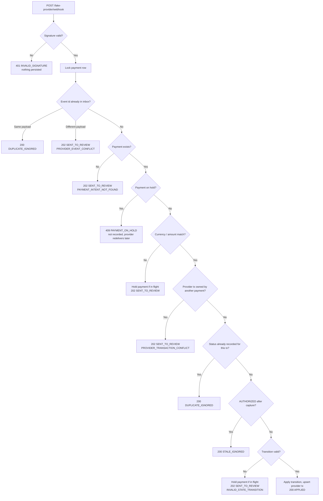
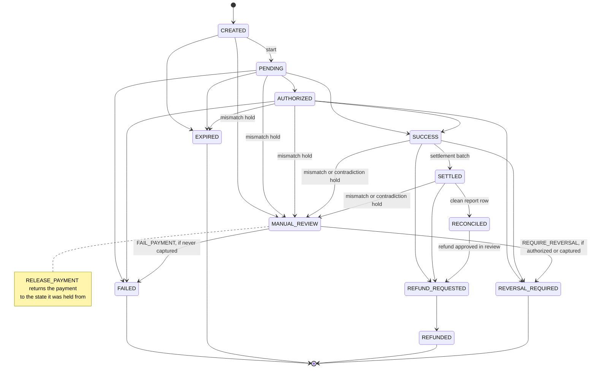

# Payflow Reliability


A local-first Spring Boot backend that simulates reliability problems commonly found in payment systems: duplicate requests, webhook retries and reordering, invalid state changes, concurrent writers, settlement mismatches, refund timing, manual review, and auditability.

This project is intentionally small. The goal is not to look senior by adding cloud services, microservices, Kafka, or managed infrastructure. The goal is to show backend judgment around state correctness, failure handling, and operational traceability, and to prove it with tests that run against the real database.

> This is a public-safe educational project based on common payment engineering patterns. It does not use proprietary employer code, architecture, data, naming, business rules, logs, screenshots, or internal workflows.

---

## What This Project Proves

- payment intent lifecycle design with guarded transitions
- idempotency for retried client requests, **including two retries racing each other**
- a webhook inbox: every provider event recorded once, with an explicit outcome
- duplicate, re-sent, and out-of-order provider webhooks absorbed without human toil
- per-payment serialization (row locks) plus optimistic versioning as a safety net
- settlement that can never pay the same transaction out twice, even under concurrent runs
- reconciliation with a per-row verdict, safe to re-import
- a manual review queue whose resolutions make real decisions (release, fail, reverse, approve or reject refund)
- refunds that are full, retry-safe, and approval-gated after reconciliation
- an audit trail and a per-payment case file that answer "what happened and what is it waiting on?"
- error responses that tell clients and the provider whether retrying can help
- explicit, versioned schema (Flyway) validated against the entities at startup
- CI on both H2 and PostgreSQL

The important part is not the framework. The important part is how the system behaves when things go wrong.

---

## Why This Project Matters

Payment systems often fail in boring but expensive ways:

- a client retries the same request and accidentally creates duplicate payments
- a provider sends the same webhook more than once, or sends events out of order
- a late webhook contradicts the current local state
- two settlement jobs run at once and pay a merchant twice
- a provider report does not match local records
- a refund is requested after settlement or reconciliation
- a payment is put "on hold" and nobody is ever responsible for releasing it
- operators need to understand what happened after the fact

This project models those failure modes in a safe, local, public portfolio repo.

---

## Tech Stack

- Java 21, Spring Boot 3.5 (Web, Validation, Data JPA, Actuator)
- PostgreSQL 16 for local runtime, H2 (PostgreSQL mode) for fast tests
- Flyway for schema migrations; Hibernate runs in `validate` mode
- Micrometer metrics via Actuator
- Maven Wrapper, Docker Compose, GitHub Actions

---

## Architecture

```text
Client / Merchant API          Fake provider             Operations
        |                            |                        |
        v                            v                        v
Spring Boot modular monolith (one transaction per request, per-payment row lock)
        |
        ├── payment         intents, idempotency, state machine, webhook inbox, provider transactions
        ├── settlement      payout batches (one currency per batch)
        ├── reconciliation  provider report import, per-row verdicts
        ├── review          review queue, resolution decisions, allowed actions
        ├── refund          full refunds, replay-safe, approval after reconciliation
        ├── operations      payment case file, operations summary
        ├── audit           append-style audit events linked to payment + request id
        └── common          error codes, request id correlation, database error mapping

PostgreSQL (schema owned by Flyway: src/main/resources/db/migration)
        ├── payment_intents         unique (merchant_id, idempotency_key), hold-state check
        ├── payment_transactions    unique provider_transaction_id
        ├── provider_events         unique provider_event_id (webhook inbox)
        ├── settlement_batches
        ├── settlement_batch_items  unique transaction_id (never paid out twice)
        ├── review_cases
        ├── refund_requests
        └── audit_events
```

---

## Webhook Decision Flow

Every authenticated delivery gets exactly one outcome. Expected outcomes are returned, not thrown, so the review cases and audit events they create are committed.



Status codes are chosen for the provider's retry logic: **2xx means stop retrying** (200 handled, 202 accepted for human review), **409 PAYMENT_ON_HOLD means redeliver later**, 401 means the signature is wrong.

---

## Payment State Machine



`MANUAL_REVIEW` is no longer a dead end. A held payment remembers `stateBeforeReview`, and releasing it returns there. Final outcomes (`FAILED`, `EXPIRED`, `REFUNDED`, ...) are facts and are never overwritten by a hold.

---

## Local Setup

### Prerequisites

- JDK 21
- Docker
- Maven, or the included Maven Wrapper

### 1. Start PostgreSQL

```bash
docker compose up -d postgres
```

> Upgrading from a version before Flyway? The old schema was created by Hibernate and has no migration history, so startup stops with a clear Flyway error. Reset the local volume once: `docker compose down -v && docker compose up -d postgres`.

### 2. Run the app

```bash
./mvnw spring-boot:run
```

Flyway applies the migrations, then Hibernate validates the entities against the schema.

No local JDK? `docker compose up --build` builds the image and runs the app and PostgreSQL together.

### 3. Health check

```bash
curl http://localhost:8080/actuator/health
```

---

## Run Tests

```bash
./mvnw test
```

The same suite runs against PostgreSQL by pointing Spring at it (CI does both):

```bash
SPRING_DATASOURCE_URL=jdbc:postgresql://localhost:5432/payflow_reliability SPRING_DATASOURCE_USERNAME=payflow_reliability SPRING_DATASOURCE_PASSWORD=payflow_reliability ./mvnw test
```

Tests are **not** wrapped in a test-managed transaction: every service call commits or rolls back exactly as in production. That matters. The earlier suite ran each test inside one transaction, which hid review cases and audit events being rolled back on rejection paths.

What is covered (85 tests):

- idempotency: replay, payload mismatch, per-merchant key scope, 8 concurrent creates with one key produce one intent
- webhooks: every outcome in the flow above, authorization-then-capture on one provider transaction, contradictions hold in-flight payments, unknown payment persisted for review, forged signature writes nothing, 6 concurrent identical deliveries apply exactly once, conflicting concurrent events serialize
- settlement: ineligible and contradicted payments skipped instead of failing the batch, 4 concurrent runs pay out once, a run racing refunds and reversal webhooks stays consistent, per-currency batches
- reconciliation: per-row outcomes, safe re-import, duplicate rows, matched-but-unsettled rows
- refunds: full refund lifecycle, partial refund rejected, retry replay, 5 concurrent requests create one refund, reconciled refund pending review, completion blocked while the provider contradicts the payment
- review: allowed actions, release / fail / reverse / approve / reject, chargeback after settlement, double resolution, two operators racing, resolution racing provider events
- HTTP contract: status codes, `Location`, `Idempotent-Replayed`, `X-Request-Id`, error codes, amount precision, case file, operations summary
- domain state machine rules in isolation

The concurrency tests were checked by mutation: removing the payment row lock, the settlement payment locks, or the version columns plus the batch-item unique constraint makes them fail (the last reproduces the original bug: four batches for the same transactions).

---

## Run the Demo

With the app running:

```bash
./scripts/demo-readable.sh
```

A narrated walkthrough: idempotent creation, authorization then capture, absorbed provider noise, an amount mismatch that is held, deferred, released and recovered, settlement, reconciliation verdicts, an approval-gated refund, a case file, and the operations summary.

`./scripts/demo.sh` is the short version. To look at one behavior in depth, with its outcome checked:

```bash
./scripts/scenarios.sh idempotency          # also: duplicate-webhook, amount-mismatch, settlement, reconciliation, audit-trail
```

Each scenario prints what happened and a PASS/FAIL line per expectation, and exits non-zero if any check fails. All scripts use fresh ids on every run, so they can be repeated without resetting the database.

---

## Screenshots

Each screenshot shows the unedited output of the command in its first line, run against the app on PostgreSQL 16 (the test screenshot runs the suite on H2 and on PostgreSQL), so any of them can be reproduced.

| Screenshot | What it shows | Reproduce |
|---|---|---|
| Demo walkthrough | Every behavior end to end, with status codes and outcomes | `./scripts/demo-readable.sh` |
| Idempotency | 201 then 200 with `Idempotent-Replayed`; 422 for a changed payload; 8 parallel retries create one payment | `./scripts/scenarios.sh idempotency` |
| Webhook redelivery | Redeliveries and a late authorization absorbed; 10 parallel deliveries applied once; no review cases | `./scripts/scenarios.sh duplicate-webhook` |
| Amount mismatch | Payment held (202), provider told to redeliver (409), operator must decide, release, recovery | `./scripts/scenarios.sh amount-mismatch` |
| Settlement | Four racing runs create one batch; a payment with a refund requested is skipped | `./scripts/scenarios.sh settlement` |
| Reconciliation | A verdict per report row; importing the same report again changes nothing | `./scripts/scenarios.sh reconciliation` |
| Audit trail | Case file timeline: every step with its actor and the request id that caused it | `./scripts/scenarios.sh audit-trail` |
| Tests | 85 tests passing on H2 and on PostgreSQL | `./mvnw test` |

### Demo walkthrough


### Idempotency


### Webhook redelivery


### Amount mismatch: hold, decide, recover


### Settlement


### Reconciliation


### Audit trail


### Tests on H2 and PostgreSQL


---

## API

### Payment intents

| Method | Path | Notes |
|---|---|---|
| POST | `/api/payment-intents` | Requires `Idempotency-Key` (per merchant, max 100 chars). **201** + `Location` when created; **200** + `Idempotent-Replayed: true` on replay; **422** `IDEMPOTENCY_KEY_REUSED` if the payload differs |
| POST | `/api/payment-intents/{id}/start` | Retrying a start on a PENDING payment is a no-op |
| GET | `/api/payment-intents/{id}` | |
| GET | `/api/payment-intents/{id}/case-file` | Everything about one payment: attention summary, provider transactions, provider events and their outcomes, settlement, refunds, review cases with allowed actions, full audit timeline |

### Fake provider webhook

| Method | Path | Notes |
|---|---|---|
| POST | `/fake-provider/webhook` | Header `X-Provider-Signature: local-demo-signature`. Returns a `WebhookResponse` with `outcome`, `detail`, `reviewReason`, `reviewCaseId`, `originalOutcome` (for redeliveries) and the payment |

### Settlement

| Method | Path | Notes |
|---|---|---|
| POST | `/api/settlements/batches?merchantId=&currency=` | **201**. `currency` is needed only if the merchant has eligible payments in several currencies (**422** `SETTLEMENT_CURRENCY_REQUIRED` lists them). **409** `NOTHING_TO_SETTLE` |
| GET | `/api/settlements/batches?merchantId=` | Newest first |
| GET | `/api/settlements/batches/{batchId}/items` | **404** for an unknown batch |

### Reconciliation

| Method | Path | Notes |
|---|---|---|
| POST | `/api/reconciliation/reports` | Up to 1000 rows per import. Returns counts plus one verdict per row: `RECONCILED`, `ALREADY_RECONCILED`, `MATCHED_NO_ACTION`, `MISMATCH` (with reasons and review case ids), `NOT_FOUND_LOCALLY`, `DUPLICATE_ROW` |

### Review cases

| Method | Path | Notes |
|---|---|---|
| GET | `/api/review-cases?status=OPEN\|RESOLVED\|ALL&reason=&paymentIntentId=` | Oldest first; defaults to open. Each case includes `paymentState` and `allowedActions` |
| GET | `/api/review-cases/{id}` | |
| POST | `/api/review-cases/{id}/resolve` | Body `{actor, note, action}`; `action` defaults to `ACKNOWLEDGE`. **422** `RESOLUTION_ACTION_NOT_APPLICABLE` explains what is allowed and why |

### Refunds

| Method | Path | Notes |
|---|---|---|
| POST | `/api/refunds/payment-intents/{paymentIntentId}` | Full amount only (**422** otherwise). **201** `REQUESTED`; **202** `PENDING_REVIEW` for a reconciled payment; **200** + `Idempotent-Replayed: true` if the payment already has this refund |
| GET | `/api/refunds/payment-intents/{paymentIntentId}` | |
| GET | `/api/refunds/{refundId}` | |
| POST | `/api/refunds/{refundId}/complete` | Completing a completed refund is a no-op; **409** `REFUND_NOT_COMPLETABLE` while pending review or after rejection |

### Audit and operations

| Method | Path | Notes |
|---|---|---|
| GET | `/api/audit-events?paymentIntentId=` | Every event about one payment, across aggregates |
| GET | `/api/audit-events?aggregateType=&aggregateId=` | One aggregate's own events |
| GET | `/api/operations/summary` | Payments per state, open review queue by reason and age, payments on hold, refunds waiting, and settlement backlog per merchant and currency |
| GET | `/actuator/metrics/payflow.webhook.events` | Tagged by `outcome` and `reason`; also `payflow.webhook.rejected`, `payflow.review.cases.opened` |

### Errors

Every non-2xx response has the same shape:

```json
{
  "timestamp": "2026-10-12T09:43:45.173830Z",
  "status": 409,
  "error": "Conflict",
  "code": "PAYMENT_ON_HOLD",
  "message": "Payment a41b6477-... is on hold for manual review. Redeliver this event after the review is resolved.",
  "retryable": true,
  "requestId": "4f12f4a7-431a-45f2-9113-e3038522ffc7"
}
```

- `code` is stable and machine-readable (`ErrorCode` lists them all).
- `retryable` says whether sending the exact same request again can succeed. `CONCURRENT_MODIFICATION`, `PAYMENT_ON_HOLD` and `INTERNAL_ERROR` are retryable; validation, business-rule rejections and `DATA_INTEGRITY_ERROR` (a deterministic constraint failure) are not.
- `requestId` matches the `X-Request-Id` response header, the log lines for that request, and the `requestId` stored on audit events. Send your own `X-Request-Id` (letters, digits, `.`, `_`, `-`, up to 64) to correlate across systems.

Amounts accept at most 2 decimal places and are returned at that scale everywhere. Previously `100.005` was echoed back to the client but silently stored as `100.01`.

---

## Example: an amount mismatch, end to end

```bash
# provider reports 124000 for a 125000 payment
curl -X POST http://localhost:8080/fake-provider/webhook \
  -H 'Content-Type: application/json' -H 'X-Provider-Signature: local-demo-signature' \
  -d '{"providerEventId": "evt-001", "providerTransactionId": "provider-tx-001",
       "paymentIntentId": "<id>", "status": "SUCCESS", "amount": 124000, "currency": "IDR"}'
```

```json
{
  "providerEventId": "evt-001",
  "outcome": "SENT_TO_REVIEW",
  "detail": "Webhook amount 124000 does not match payment amount 125000.00. Payment held in MANUAL_REVIEW.",
  "reviewReason": "AMOUNT_MISMATCH",
  "reviewCaseId": "7541caac-...",
  "paymentIntent": { "state": "MANUAL_REVIEW", "stateBeforeReview": "PENDING", "...": "..." }
}
```

The provider's corrected event now gets `409 PAYMENT_ON_HOLD` (retryable), so the provider keeps it. The review queue tells the operator what they can do:

```bash
curl 'http://localhost:8080/api/review-cases?paymentIntentId=<id>'
# ... "allowedActions": ["RELEASE_PAYMENT", "FAIL_PAYMENT"]

curl -X POST http://localhost:8080/api/review-cases/<case-id>/resolve \
  -H 'Content-Type: application/json' \
  -d '{"actor": "ops-ana", "note": "Provider confirmed a display bug", "action": "RELEASE_PAYMENT"}'
```

The payment returns to `PENDING`, the provider's next redelivery is `APPLIED`, and the case file shows the whole story.

---

## Failure Scenarios Modeled

See [docs/failure-scenarios.md](docs/failure-scenarios.md) for each scenario with its expected behavior and the test that proves it. In short:

| Scenario | Behavior |
|---|---|
| Client retries create | Same intent returned; concurrent retries also converge on one intent |
| Same key, different payload | 422, original untouched |
| Provider redelivers an event | 200 `DUPLICATE_IGNORED`, no review case (retries are normal, not incidents) |
| Same event id, different payload | Review case `PROVIDER_EVENT_CONFLICT` |
| Authorization then capture on one provider transaction | Both applied; payment becomes settleable |
| Authorization arrives after capture | 200 `STALE_IGNORED` |
| Contradictory late event (FAILED after SUCCESS, chargeback after settlement) | In-flight payment held so nothing settles; final payment left alone; review case either way |
| Contradiction on a refund-requested payment | Refund completion blocked until an operator resolves the case |
| Amount or currency mismatch | In-flight payment held; final payment left alone; review case either way |
| Event while payment is on hold | 409, provider redelivers after the review decision |
| Forged signature | 401, nothing written |
| Concurrent settlement runs | One batch; the others get 409; DB constraint guarantees no double payout |
| Refund or reversal before settlement | Payment skipped by settlement instead of blocking the merchant's batch, even when they race the run |
| Reconciliation mismatch | Per-row verdict plus review case; re-import is safe |
| Refund after reconciliation | 202 `PENDING_REVIEW`; operator approves or rejects |
| Partial refund | 422; full refunds only |

---

## Design Choices

### Modular monolith over microservices

Easier to run, test, and reason about; no fake distributed complexity. Correctness problems here are transaction problems, and a single database transaction is the right tool.

### Per-payment serialization, optimistic versions as the safety net

Every flow that changes one payment takes a row lock on it first, so concurrent deliveries and requests for the same payment queue up and each sees the previous one's result. Settlement locks all its candidate payments in id order before touching their transactions, the same payment-then-transaction order webhooks use. Every mutable entity also has a `@Version`, and the schema enforces the invariants that must survive any bug: one intent per (merchant, key), one row per provider transaction, one inbox row per provider event, one settlement item per transaction. See [ADR 009](docs/adr/009-concurrency-control.md).

### Return outcomes, do not throw them

A duplicate webhook, a mismatch, or a refund that needs approval are expected outcomes, not errors. Returning them means the review case and audit event they create commit with the request. Throwing rolled them back silently. See [ADR 010](docs/adr/010-webhook-inbox-and-outcomes.md).

### Review resolutions are decisions

The queue exists to decide what happens to money, so resolving a case applies a decision, and each case advertises the decisions that are valid right now. See [ADR 011](docs/adr/011-review-decisions.md).

### Explicit schema

`ddl-auto: update` silently mutates production schemas and cannot express the constraints above. Flyway owns the schema; Hibernate only validates. See [ADR 012](docs/adr/012-schema-migrations.md).

### PostgreSQL locally, H2 and PostgreSQL in CI

H2 keeps the inner loop fast. PostgreSQL in CI catches what H2 hides. It already caught one: Hibernate classifies unique violations differently on PostgreSQL, which broke the idempotency race handling until the check moved to the portable SQLState.

### Fake provider, no cloud

No billing risk, no secrets, no compliance concerns. The value is in the behavior, not the hosting.

---

## Documentation Map

- [Demo Flow](docs/demo-flow.md)
- [Architecture Flow](docs/architecture-flow.md)
- [Failure Scenarios](docs/failure-scenarios.md)
- [Security Review](docs/security-review.md)
- [Interview Defense](docs/interview-defense.md)
- [Architecture Decision Records](docs/adr)

---

## Continuous Verification

GitHub Actions runs the full suite twice on every push to `main`, `dev`, `dev/**` and on pull requests into `main` and `dev`: once on H2 and once on a PostgreSQL 16 service container. No deployment, registry publish, or scheduled workflow is included.

---

## Limitations

Intentional omissions:

- no real payment gateway, card data, or PCI-DSS scope
- no authentication or authorization on merchant or operations endpoints; the review `actor` is self-declared
- the provider signature is a static shared secret compared in constant time, not an HMAC over the body with a timestamp
- full refunds only; partial refunds need refunded-amount tracking and a partially-refunded state
- reconciliation is one-sided: it checks reported rows against local data but does not yet flag local settled payments missing from a report
- no expiry sweep for CREATED or PENDING payments that never hear back from the provider
- open review cases are deduplicated by lookup, not by a database constraint, so two truly simultaneous identical problems can open two cases
- a refund blocked by a contradiction can be completed after acknowledgement, but there is no action to cancel a requested refund
- reconciliation does not lock payments, so two overlapping imports at the same moment can conflict (409, retryable; re-import is safe)
- no multi-region behavior, queues, or distributed locking

---

## What To Review First

1. Run `./scripts/demo-readable.sh`, or one `./scripts/scenarios.sh` scenario
2. `ProviderWebhookService`: the decision order and why each outcome has its status code
3. `PaymentIntent`: the state machine and hold rules
4. `ReviewWorkflowService`: how resolutions become decisions
5. `SettlementService` and `V1__baseline_schema.sql`: how double payout is prevented twice over
6. `ProviderWebhookTest`, `SettlementTest`: the concurrency tests

The core idea: this is a small backend system built around safe payment-state handling, not a generic CRUD tutorial.
