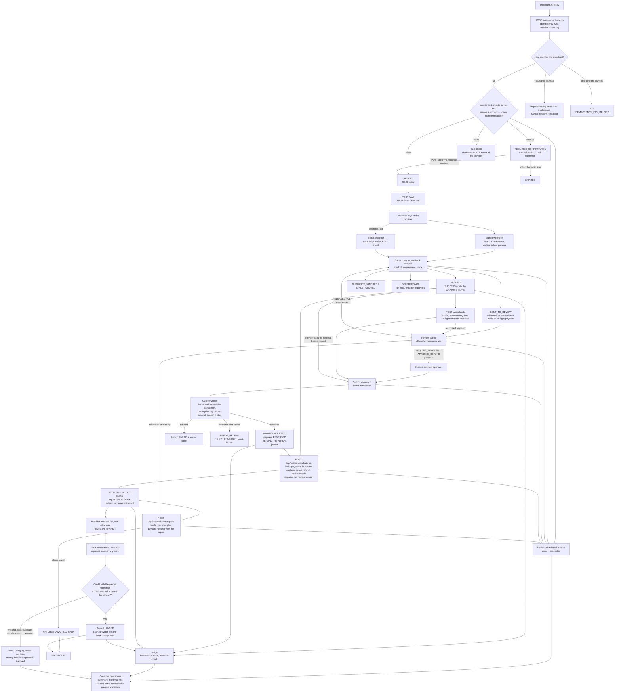

# Architecture Flow

End-to-end lifecycle of a payment, from creation to the bank statement, including the provider, the bank, the
background workers, and where humans decide. The webhook decision order is in the
[README](../README.md#webhook-decision-flow).

## Lock order

Every flow that changes a payment locks the payment row first (several payments: in id order), then
dependent rows. Provider calls happen outside transactions. This single order is why concurrent webhooks,
settlement runs, refunds, review decisions and the outbox worker queue instead of deadlocking.

## Background jobs

| Job | Default interval | Purpose |
|---|---|---|
| Outbox worker | 1 s | Executes refunds, reversals and payouts at the provider |
| Provider simulator dispatcher | 1 s | Delivers simulated webhooks with retries (local only) |
| Bank statement pull | 1 min | Imports every statement the bank has that is not complete here yet |
| Bank simulator day close | 1 min | Closes elapsed business days and issues their statements (local only) |
| Status sweeper | 5 min | Recovers lost webhooks, expires abandoned payments and unconfirmed step-ups |
| Ledger invariant check | 5 min | Books versus operational records, bank statements and open breaks |
| Three-way reconciliation | 5 min | Matches suspense lines, declares missing credits, reconciles payments |
| Idempotency cleanup | 1 h | Removes stored responses after 24 h |
| Metrics refresh | 30 s | Snapshot behind the alerting gauges |

All are switched off together with `payflow.workers.enabled=false` (tests run them explicitly).
