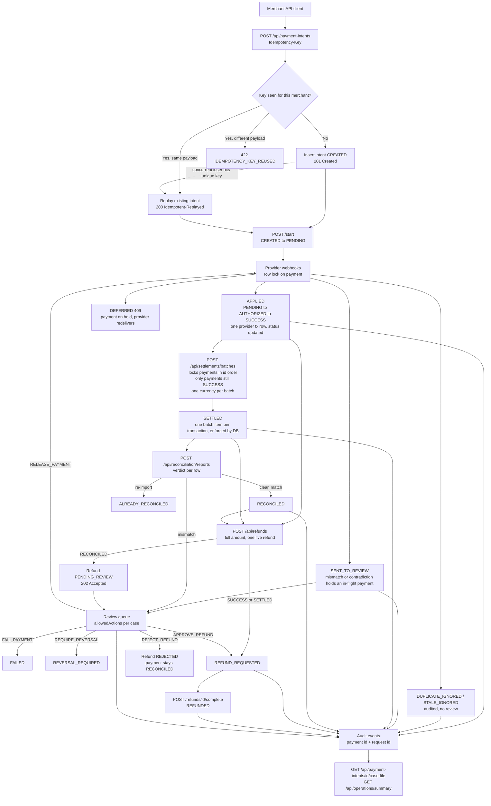

# Architecture Flow

End-to-end lifecycle of a payment, from creation to reconciliation and refund, including where humans decide. The webhook decision order is in the [README](../README.md#webhook-decision-flow).

