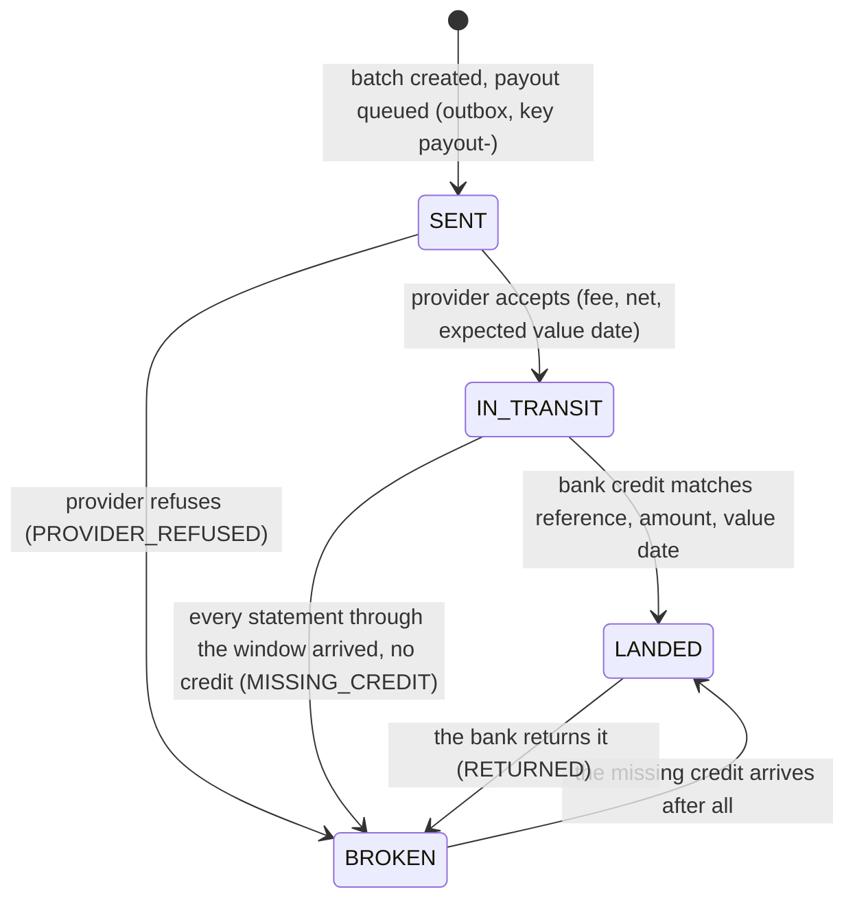
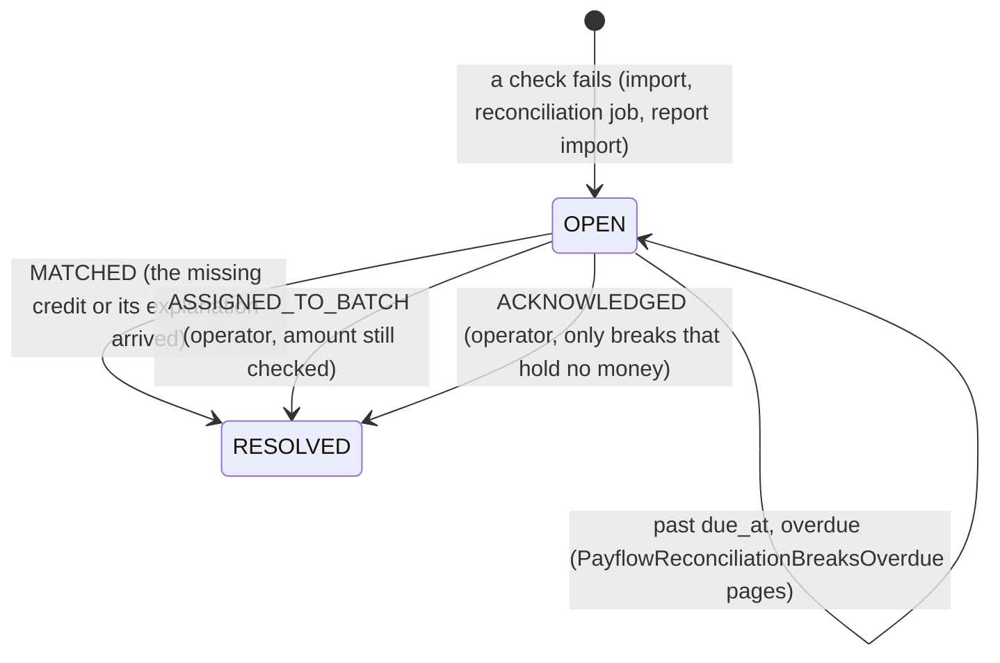

# Settlement Certainty

> "Idempotency checks are table stakes. They don't fix double payments unless you get the key generation and
> reconciliation right. Latency monitoring and device attestation are nice demos, but where is settlement
> certainty?"

This page answers that critique in one place. It explains, with the code and tests that prove each claim:

1. [what we know about a payment's money at each stage, and what evidence proves it](#1-what-is-known-at-each-stage);
2. [how the ledger, the provider's report and the bank statement are matched three ways](#2-the-three-way-match);
3. [what happens to every disagreement: breaks, owners, aging](#3-breaks-every-disagreement-has-an-owner);
4. [how slowness and device risk show up as money in the same system](#4-slowness-and-device-risk-as-money);
5. [how all of this is tested together](#5-proof-under-chaos);
6. [what this project does not do](#6-honest-limits).

Every claim has a scenario you can run against the app, with the numbers it prints: see
[Run it yourself](#run-it-yourself).

Key generation, the other half of the critique, has its own page: [Idempotency keys: the client contract](idempotency-keys.md)
and [ADR 024](adr/024-idempotency-keys-end-to-end.md).

---

## 1. What is known at each stage

A payment's money passes through five stages. At each one we know something specific, and only something
specific. The mistake the critique points at is treating an earlier stage as a later one: "the provider said it
paid us" is not "the money is in our bank".

| Stage | What we know | Evidence | Where it lives |
|---|---|---|---|
| **Authorized** | The provider will let us take the money | an authenticated provider event (signed webhook or status poll) | `provider_events` (inbox) |
| **Captured** | The provider took the customer's money and holds it for us | the capture event, and a `CAPTURE` journal: provider_receivable / merchant_payable | `ledger_journals` |
| **Paid out by the provider** | The provider says it sent our payout: gross, its fee, net, expected value date | the provider's answer to the payout call (`PAYOUT_IN_TRANSIT` journal), later its settlement report | `settlement_batches`, `provider_payout_reports` |
| **Landed in the bank** | The money is in our settlement account | a bank statement line matched by reference, amount and value date (`PAYOUT_LANDED` journal) | `bank_statements`, `bank_statement_lines` |
| **Reconciled** | All three records agree about this payment | a clean provider report row **and** a landed payout | payment state `RECONCILED` |

Every payment's case file (`GET /api/payment-intents/{id}/case-file`) lists these stages under `certainty`, each
with `known` and the evidence:

```json
"certainty": [
  {"stage": "AUTHORIZED",           "known": true, "evidence": "WEBHOOK event sim_evt_... (SUCCESS)"},
  {"stage": "CAPTURED",             "known": true, "evidence": "CAPTURE journal 9c1e..."},
  {"stage": "PAID_OUT_BY_PROVIDER", "known": true, "evidence": "provider payout sim_po_... for batch PFB..."},
  {"stage": "LANDED_IN_BANK",       "known": true, "evidence": "bank line BNK... in statement STMT-IDR-20261017-2, value date 2026-10-17"},
  {"stage": "RECONCILED",           "known": true, "evidence": "provider report matched on ... and the payout landed"}
]
```

### The payout lifecycle

A settlement batch is a payout with its own lifecycle. Only the bank can finish it:



### The ledger follows the money

One account per stage, so the books say exactly where the money is. Example: a batch of 3000.00 IDR, a provider
fee of 30 bps (9.00), and a bank charge of 6.50 deducted on the way in:

| Event | Debit | Credit | Amount |
|---|---|---|---|
| captures | provider_receivable | merchant_payable:M | 3000.00 |
| batch created | merchant_payable:M | payouts_due:M | 3000.00 |
| provider accepts | payouts_in_transit | provider_receivable | 3000.00 |
| credit matched | bank_cash 2984.50, provider_fees 9.00, bank_charges 6.50 | payouts_in_transit | 3000.00 |

Fees are booked as their own lines, so **gross minus fees equals net to the cent**, or the journal does not
balance and the ledger refuses to post it. An unexplained credit goes to `bank_suspense`; a returned payout goes
back to `provider_receivable`.

---

## 2. The three-way match

### The three legs

| Leg | Source | What it says |
|---|---|---|
| Ledger | our journals and settlement batches | what we owe, what we committed to pay out, what we expect |
| Provider | its answer to the payout call, and its settlement report (`POST /api/reconciliation/reports`, with `payouts`) | what it says it sent: gross, fee, net, value date, and which transactions it settled |
| Bank | camt.053 end-of-day statements (`POST /api/bank/statements`, or pulled from the bank's feed) | what actually arrived, when, minus what |

### The matching rules

A bank credit lands a payout only when **all three** hold. There is no matching by amount alone.

| Check | Rule | If it fails |
|---|---|---|
| reference | end-to-end id = payout reference (`PFB` + batch id, 35 characters) | `UNMATCHED_CREDIT`, money held in suspense |
| amount | received + itemized bank charges = the net the provider said it sent; gross - fee = net | `AMOUNT_MISMATCH`, held in suspense |
| value date | at most the expected value date + 2 days (`payflow.reconciliation.value-date-window-days`) | `LATE_CREDIT`, held in suspense until someone accepts it |

The per-batch view shows every check, side by side: `GET /api/reconciliation/three-way/batches/{batchId}`.

Per payment, RECONCILED needs **two** pieces of evidence: the provider's report row matched it, and the bank
landed its payout. Whichever arrives second completes it; in between the report import answers
`MATCHED_AWAITING_BANK`.

### Statements: idempotent and order-independent

| Situation | What happens | Why it is safe |
|---|---|---|
| The same statement imported twice | `ALREADY_IMPORTED`, nothing booked | statement id + content hash |
| Same id or number, different content | `CONFLICT` (409), nothing imported, a break | a bank cannot have two versions of one statement |
| A statement repeating yesterday's entry | the entry is skipped, treasury gets a break | each line's identity includes the bank's own entry reference |
| Statements arriving out of order | each line books the same; coverage advances only over consecutive numbers | a gap is never mistaken for a missing credit |
| A credit arriving before the provider confirmed | held in suspense; matched by the next reconciliation run | the job retries suspense lines |

### The statement format (camt.053 subset)

The bank simulator issues, and the parser reads, this subset of ISO 20022 `camt.053.001.08`. The parser refuses
DTDs and external entities, statements that do not add up, amounts with more decimals than the currency allows,
and anything that is not one booked statement:

```xml
<Document xmlns="urn:iso:std:iso:20022:tech:xsd:camt.053.001.08">
  <BkToCstmrStmt>
    <GrpHdr><MsgId>MSG-STMT-IDR-20261017-2</MsgId><CreDtTm>2026-10-17T17:00:00Z</CreDtTm></GrpHdr>
    <Stmt>
      <Id>STMT-IDR-20261017-2</Id>
      <ElctrncSeqNb>2</ElctrncSeqNb>
      <Acct><Id><Othr><Id>PAYFLOW-SETTLE-IDR</Id></Othr></Id><Ccy>IDR</Ccy></Acct>
      <Bal><Tp><CdOrPrtry><Cd>OPBD</Cd></CdOrPrtry></Tp><Amt Ccy="IDR">0.00</Amt><CdtDbtInd>CRDT</CdtDbtInd><Dt><Dt>2026-10-17</Dt></Dt></Bal>
      <Bal><Tp><CdOrPrtry><Cd>CLBD</Cd></CdOrPrtry></Tp><Amt Ccy="IDR">2984.50</Amt><CdtDbtInd>CRDT</CdtDbtInd><Dt><Dt>2026-10-17</Dt></Dt></Bal>
      <Ntry>
        <Amt Ccy="IDR">2984.50</Amt>
        <CdtDbtInd>CRDT</CdtDbtInd>
        <RvslInd>false</RvslInd>
        <Sts><Cd>BOOK</Cd></Sts>
        <BookgDt><Dt>2026-10-17</Dt></BookgDt>
        <ValDt><Dt>2026-10-17</Dt></ValDt>
        <AcctSvcrRef>BNK8F21C0A7E4D2B19C6A5F</AcctSvcrRef>
        <BkTxCd><Domn><Cd>PMNT</Cd><Fmly><Cd>RCDT</Cd><SubFmlyCd>ESCT</SubFmlyCd></Fmly></Domn></BkTxCd>
        <Chrgs><TtlChrgsAndTaxAmt Ccy="IDR">6.50</TtlChrgsAndTaxAmt><Rcrd><Amt Ccy="IDR">6.50</Amt><CdtDbtInd>DBIT</CdtDbtInd><ChrgInclInd>true</ChrgInclInd></Rcrd></Chrgs>
        <NtryDtls><TxDtls>
          <Refs><AcctSvcrRef>BNK8F21C0A7E4D2B19C6A5F</AcctSvcrRef><EndToEndId>PFB3F0C9A0D2E7B4C1A9F8E6D5C4B3A2910</EndToEndId></Refs>
          <AmtDtls><InstdAmt><Amt Ccy="IDR">2991.00</Amt></InstdAmt></AmtDtls>
          <RltdPties><Dbtr><Nm>Simulated Payment Provider</Nm></Dbtr></RltdPties>
          <RmtInf><Ustrd>PAYOUT PFB3F0C9A0D2E7B4C1A9F8E6D5C4B3A2910 merchant-demo</Ustrd></RmtInf>
        </TxDtls></NtryDtls>
      </Ntry>
    </Stmt>
  </BkToCstmrStmt>
</Document>
```

| Element | Used for |
|---|---|
| `Stmt/Id`, `ElctrncSeqNb` | idempotency and coverage (which days are complete) |
| `Acct/Id/Othr/Id`, `Acct/Ccy` | which settlement account, which currency |
| `Bal` `OPBD` / `CLBD` | the statement must add up, and chain to its neighbours |
| `Ntry/Amt`, `CdtDbtInd`, `RvslInd` | what moved, in which direction, and whether it reverses an earlier credit (a return) |
| `ValDt` | the value-date window |
| `AcctSvcrRef` | the bank's own entry reference: part of each line's identity |
| `Refs/EndToEndId` | the payout reference; `NOTPROVIDED` counts as no reference |
| `Chrgs/Rcrd/Amt`, `AmtDtls/InstdAmt` | itemized bank charges, and what the sender instructed |

---

## 3. Breaks: every disagreement has an owner

A **break** is a disagreement between the legs that a person has to resolve. Each has a category, an owner, an
amount, the money it holds in suspense (if any), an opening time and a due time.

| Category | Owner | Due after | Holds money in suspense |
|---|---|---|---|
| `MISSING_CREDIT` | treasury | 24 h | no (the money never arrived) |
| `RETURNED_PAYOUT` | treasury | 24 h | no (back with the provider) |
| `STATEMENT_CONFLICT` | treasury | 24 h | no |
| `UNMATCHED_CREDIT`, `UNMATCHED_DEBIT` | treasury | 48 h | yes |
| `LATE_CREDIT` | treasury | 48 h | yes |
| `DUPLICATE_CREDIT` | treasury | 72 h | yes |
| `AMOUNT_MISMATCH` | provider operations | 48 h | yes |
| `PROVIDER_REFUSED_PAYOUT` | provider operations | 24 h | no (still with the provider) |
| `PROVIDER_PAYOUT_MISMATCH`, `MISSING_FROM_PROVIDER_REPORT`, `UNKNOWN_PROVIDER_PAYOUT` | provider operations | 72 h | no |

The lifecycle:



Money held in suspense is never released by a click: only a matching bank line, a return, or an assignment
(which still checks the amount) closes such a break. The ledger check proves that `bank_suspense` equals the sum
over open breaks, to the cent.

Operations: `GET /api/reconciliation/breaks?status=OPEN`, `POST /api/reconciliation/breaks/{id}/resolve`, and
the [runbook](runbook.md#reconciliation-breaks-overdue). The reconciliation job and the statement feed each have a
dead man's switch, so a job that silently stops is an alert too.

---

## 4. Slowness and device risk as money

Settlement certainty is about money that already moved. Two other things decide how much money moves at all,
and both are usually shown as technical charts: a provider that is slow but "up", and a device-risk check. Here
both are measured in the same currency as everything else, from the payment system's own records.

### 4.1 Slow but up

A provider whose payment page takes six seconds fails no health check. Customers still leave, paid payments sit
unconfirmed, and impatient customers press pay again. Whether that retry is harmless or a second charge depends
only on the shop reusing its idempotency key. ([ADR 027](adr/027-slowness-as-money.md))

| Measure | From | Exposed as |
|---|---|---|
| payments past the confirmation SLO (10 s) | started, still unconfirmed | money at risk `PENDING_BEYOND_SLA` (count, amount) |
| abandoned checkouts | payments the shop cancelled with reason `ABANDONED` | money at risk `ABANDONED` (count, amount, amount per minute over 15 min) |
| retries absorbed | creates answered with the original payment | `payflow_idempotency_replays_total` |
| duplicate charges | a merchant reference captured more than once | money at risk `DUPLICATE_CHARGES` (must stay zero) |
| confirmation SLO burn | every confirmation counted in or out of the SLO | `payflow_payment_confirmations_total{within_slo}` |

`PayflowSlowButUp` pages when health is UP **and** money is at risk (three payments past the SLO, or three
abandoned checkouts in ten minutes); `promtool test rules` proves it fires when slow and stays silent when down
(`ops/prometheus/alerts.test.yml`).

The `slow-but-up` scenario runs 40 seeded customers against a normal provider and 40 against a slow one, through
the public API. Every figure below is printed by that run (seed 42) and repeats exactly:

| | Simulated customers (ground truth) | Measured by the payment system |
|---|---|---|
| normal provider | 40 paid, 0 left, 0 retries | |
| slow provider: paid, unconfirmed | 24 paid, 7,073,000 IDR | 24 past the SLO, 7,073,000 IDR |
| slow provider: gave up | 16, 4,369,000 IDR | 16 abandoned, 4,369,000 IDR (291,266 IDR per minute) |
| retries | 23, all answered by the idempotency key | 0 duplicate charges |
| health | | UP throughout |

With `keyStrategy: PER_ATTEMPT` (a key per click, the anti-pattern) every retry becomes a second charge, and the
payment system counts each one (`CheckoutLoadTest.shouldShowWhatAKeyPerAttemptCosts`).


### 4.2 Device risk

[trustgate-android](https://github.com/fattah247/trustgate-android) is the client half: it detects device signals
and signs step-up confirmations. Payflow is the server half: it takes the decision when a payment is created,
where the amount and what is bought are known and the decision cannot be patched out of the app.
([ADR 028](adr/028-device-risk-as-money.md) has the field-by-field contract.)

| Points | Rule |
|---|---|
| device | the detected signals' weights: LOW 1, MEDIUM 2, HIGH 3 (the app's own weights) |
| amount | +1 from IDR 1,000,000, +1 more from IDR 5,000,000 |
| action | physical goods 0, digital goods 1, stored value 2 |
| decision | any HIGH signal blocks; 5+ points block; 2+ points require a step-up; else allow |

With amount and action points off, the policy decides exactly like the app's gate, for all 256 combinations of the
app's signals (`DeviceRiskPolicyTest`). The device's own claimed level is recorded and ignored.

- **Step-up**: the payment waits in `REQUIRES_CONFIRMATION`. Starting it fails (`409 STEP_UP_REQUIRED`) until the
  shop relays the customer's confirmation with the required method (`STEP_UP_KEY` when the device has one, else
  `TAP`). Unconfirmed step-ups expire.
- **Block**: `BLOCKED` is final. Starting fails (`422 PAYMENT_BLOCKED`), so it never reaches the provider. A
  capture for it anyway goes to review and is never applied.
- **Evidence**: each decision is stored with its rule and points, written to the payment's hash-chained audit
  trail, shown in the case file, and counted as money at risk (awaiting confirmation, blocked today).

Whether the gate is worth it is a money question. The `device-risk` scenario runs 200 labelled, seeded customers
(fraud share, devices and confirmation rates are model assumptions, never data) and then asks the payment system,
which only knows its decisions and the labels disclosed afterwards:

| | Honest | Fraud |
|---|---|---|
| allowed | 128 (79,042,000 IDR) | 2 (850,000 IDR) |
| stepped up, confirmed | 35 (38,433,000) | 1 (2,735,000) |
| stepped up, gave up | 5 (5,674,000) | 13 (34,446,000) |
| blocked | 2 (1,689,000) | 14 (37,665,000) |

Measured from decisions and labels, equal to the ground truth to the rupiah: fraud stopped 27 payments
(72,111,000 IDR), fraud loss 3 (3,585,000), honest money lost to friction 7 (7,363,000); precision 0.400, recall
0.933.

**Moving one threshold.** `GET /api/risk/threshold-sweep` re-decides every labelled payment from its stored points:

| Step-up threshold | Flagged | Fraud loss (IDR) | Honest lost to friction (IDR) | Precision | Recall |
|---|---|---|---|---|---|
| 1 | 123 | 3,585,000 | 12,802,125 | 0.228 | 0.933 |
| **2 (configured)** | 70 | 3,585,000 | 7,363,000 | 0.400 | 0.933 |
| 3 | 40 | 13,281,000 | 2,514,000 | 0.625 | 0.833 |
| 4 | 27 | 28,624,000 | 2,514,000 | 0.704 | 0.633 |
| 5 | 16 | 38,031,000 | 1,689,000 | 0.875 | 0.467 |

Read it as a price list: raising the step-up threshold from 2 to 3 saves about 4.8 million IDR of honest sales and
costs about 9.7 million IDR of extra fraud, in this model. Rows other than the configured one are expected values
(a step-up the payment never had is valued at the observed confirmation rate for its label).


### 4.3 One view of money at risk

Everything above lands in one place: `GET /api/operations/money-at-risk` (optionally `?merchantId=`), the
operations summary, and the gauges `payflow_money_at_risk_count{kind}` and `payflow_money_at_risk_amount{kind,currency}`.

| Kind | Money that is... |
|---|---|
| `PENDING_BEYOND_SLA` | paid by the customer, unconfirmed past the SLO |
| `ABANDONED` | lost to customers who gave up (last 15 minutes, and per minute) |
| `DUPLICATE_CHARGES` | charged twice for one merchant reference (must be zero) |
| `HELD_FOR_REVIEW` | frozen until an operator decides |
| `BREAKS_OPEN_UNDER_1_DAY`, `BREAKS_OPEN_1_TO_3_DAYS`, `BREAKS_OPEN_OVER_3_DAYS` | in an open reconciliation break, by age |
| `AWAITING_CONFIRMATION` | waiting for a device-risk step-up |
| `BLOCKED_TODAY` | stopped by device risk today |

---

## 5. Proof under chaos

Example tests check stories someone thought of. Incidents are combinations nobody wrote down. So the money rules
are production code, checked on demand (`GET /api/operations/invariants`), and three different things try to break
them.

### 5.1 The money rules

| Rule | It means |
|---|---|
| `BOOKS_BALANCE` | every journal balances; the books agree with payments, refunds, payouts, bank statements and open breaks, to the cent |
| `CAPTURE_PAID_OUT_AT_MOST_ONCE` | no capture is in two payouts |
| `RECONCILED_ONLY_WITH_A_BANK_LINE` | no payment is RECONCILED unless a bank credit landed its payout |
| `UNMATCHED_MONEY_HAS_A_BREAK` | every bank line in suspense has an open break saying why |
| `BANK_ENTRY_BOOKED_ONCE` | the bank's own entry reference is booked once, however often it is delivered |
| `LANDING_IS_PROVEN` | every landed payout carries its reference, or a named operator assigned it |
| `BLOCKED_NEVER_REACHES_THE_PROVIDER` | a blocked payment is never started, captured or sent to the provider |
| `STEP_UP_CONFIRMED_BEFORE_CAPTURE` | a step-up payment starts, and so captures, only after it was confirmed |
| `PAYMENT_CHANGES_ANNOUNCED` | every payment change has an event for the shop, and the latest one announces the current state ([ADR 030](adr/030-merchant-notifications.md)) |
| `NO_RETRY_CHARGES_TWICE` | no merchant reference charged twice; no idempotency key applied twice at the provider |
| `REFUNDED_ONCE` | what the provider refunded equals what we recorded, plus refunds in flight |
| `PAYOUT_SENT_ONCE` | the provider paid each batch out at most once |

Together they state the critique's demands: every capture paid out at most once, every journal balanced, bank
credits equal to payouts minus fees plus or minus open breaks to the cent, every unmatched item in the breaks
queue with a reason, nothing reconciled without a bank line, no blocked payment at the provider, no unconfirmed
step-up captured, no retry charging twice.

### 5.2 Random histories (property-based test)

`MoneyInvariantPropertyTest` (jqwik) generates 50 sequences of 20 to 60 actions per run and plays each against the
real application, simulators included: retried checkouts; payments with duplicated, lost and reordered webhooks;
refunds while the provider is down, commits then times out, or refuses; workers killed right after the provider
acted; racing settlement runs; chargebacks around payout; every bank fault; statements re-imported, reversed or
re-issued; slow-provider periods; abandoned checkouts; device-risk decisions, including a provider charging a
blocked or unconfirmed payment. Then the system settles down and every rule must hold. A failure is shrunk to the
shortest sequence that still breaks a rule, with the seed to replay it.

A property that only walks the happy path proves nothing, so each run also checks it reached the hard states often
enough: payouts landed and broken, money in suspense, payments reconciled three ways, workers crashed, statements
re-issued, payments blocked, step-ups confirmed and captured, rogue provider charges, slow periods.

### 5.3 Breaking the rules on purpose (mutation checks)

Each protection was removed in turn and the whole suite run. Every mutation was caught, and the property-based test
caught every one on its own:

| Mutation | Caught by |
|---|---|
| match a bank credit by amount when the reference is missing | property test, `ThreeWayReconciliationTest` |
| skip the fee lines when a payout lands | property test and 4 more classes |
| accept a re-imported statement (no statement or line dedupe) | property test, `ThreeWayReconciliationTest` |
| scope a bank line's identity to its statement (a re-issued copy books again) | property test, `ThreeWayReconciliationTest` |
| regenerate the outbound idempotency key per attempt | property test and 4 more classes |
| record a step-up decision but let the payment through unconfirmed | property test and 3 more classes |
| remove the start guard for step-up payments | property test, `DeviceRiskFlowTest` |
| record a block but let the payment through | property test and 3 more classes |
| remove the start guard for blocked payments | property test, `DeviceRiskFlowTest` |

### 5.4 Chaos against the running application

The `chaos` scenario does the same live: `POST /api/simulations/chaos-runs` plays a seeded sequence (seed 42, 150
steps) through the public APIs of the shop, the provider and the bank, lets everything settle, and returns what
happened and every rule. On a fresh database it played, among others, 37 checkouts and 5 with device evidence,
22 payments, 14 refunds (3 with the provider committing then timing out, 5 while it was down), 12 settlement runs
(7 of them racing), 4 chargebacks, 9 bank faults, a slow period and 11 duplicated and 4 lost webhooks. The run in
the screenshot ended with 4 payouts (2 landed, 1 credit missing, 1 returned), 3 open breaks each with an owner, and
all 12 rules holding.

The seed fixes the actions and the faults, not how they interleave with the running app's own background jobs
(webhook delivery, provider calls, statement pulls). So the ending can differ between runs by a payout or a break:
three runs from the same seed ended with 3, 4 and 4 payouts. The rules held in every one, which is the point; the
property-based test, where the jobs run only when the history says so, is the reproducible version.


---

## Run it yourself

Start the app (`docker compose up -d postgres && ./mvnw spring-boot:run`, see the README), then run any scenario.
Each prints what happened and PASS/FAIL checks, and exits non-zero on a failure. CI runs all of them against the
packaged app on PostgreSQL.

| Scenario | What it proves | Key numbers (fresh database, CI order) |
|---|---|---|
| `outbound-key-crash` | the provider refunds then times out; the retry reuses `refund-<id>` and looks it up | 1 refund applied, 1 refund journal; payout `payout-<batch>` applied once, net 149,550 |
| `bank-reconciliation` | the provider's report alone reconciles nothing; the matched credit lands the payout | 750,000 gross, fee 2,250, net 747,750 credited; 3 payments RECONCILED, 0 breaks |
| `fee-deduction` | provider fee and bank charge as their own lines | 500,000 = 492,000 + 1,500 + 6,500 |
| `missing-credit` | missing only after the window; break owned by treasury | IN_TRANSIT, then BROKEN (MISSING_CREDIT), 299,100 at risk |
| `returned-payout` | a credit then its return | MATCHED 199,400 and RETURN -199,400; back to provider_receivable |
| `statement-reimport` | twice by hand, re-sent, re-issued | 1 bank line, 1 landing journal; the re-issued copy opens a break |
| `slow-but-up` | slowness in money, health UP | 16 abandoned (4,369,000), 24 past SLO (7,073,000), 0 duplicates |
| `device-risk` | step-up, block, and the price of a threshold | precision 0.400, recall 0.933, fraud loss 3,585,000, friction 7,363,000 |
| `chaos` | seeded faults, live | 150 steps, 12 of 12 rules hold (the ending can vary, see 5.4) |
| `merchant-webhooks` | the shop is told once and in order through an outage and a secret rotation | 5 events delivered, 1 retried, its late copy ignored as stale, a forgery refused |

Dates and statement numbers depend on how far the simulated bank's calendar has moved, so they differ when a
scenario runs on its own; amounts and counts do not.

---

## 6. Honest limits

- **Everything outside this application is simulated.** The provider, the bank and (for the load and risk
  numbers) the customers are simulators in this repository. Their behavior is deliberately realistic, but no real
  rail, bank file format variant or provider quirk has been tested against.
- **One settlement account per currency, one currency per payout.** No FX, no multi-bank routing, no
  correspondent banking.
- **Payouts stop at our settlement account.** Transferring `payouts_due` on to each merchant's own bank (a
  payment file out, debit lines matched in the same statement) is the next leg and is not modelled.
- **A subset of camt.053.** Intraday (camt.052) and notification (camt.054) messages, batch bookings with several
  transactions per entry, and bank-specific extensions are not handled.
- **Unexplained money stays visible.** Real finance teams eventually write unexplained receipts off to income;
  this project deliberately keeps every such amount in suspense with an open break.
- **Legacy batches are trusted.** Payouts made before the bank leg existed have no statements to match; they are
  marked `LEGACY` and reconcile on the provider's report alone, as before.
- **Customers and fraudsters are models.** Patience, abandonment, fraud share, device profiles and step-up
  completion are parameters (`payflow.loadgen.*`, `RiskTrafficGenerator`), echoed in every run with a disclaimer.
  The numbers show what the mechanisms measure, not what any real shop loses.
- **Device risk decides per payment.** A new idempotency key with cleaned evidence is a new payment with a new
  decision; correlating attempts by device, card or account (velocity rules) is out of scope. Signals from the app's
  own checks are self-reported; only attestation-backed signals resist a compromised device, and verifying
  attestation is the app backend's job.
- **Labels are complete only in a simulation.** In production blocked payments are rarely labelled, so precision
  measured on live data is biased; real systems keep a small random holdout.
- **Chaos is a sample.** The property test explores 50 random histories per run and the live chaos run one seeded
  sequence; together with the mutation checks they make the rules hard to break, not proven unbreakable.
